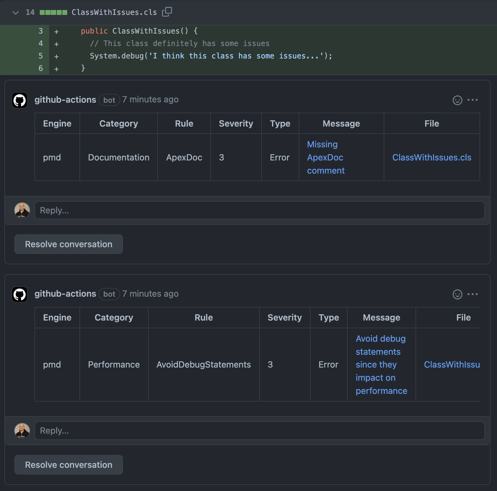

# sfdx-scan-pull-request

Runs [Salesforce Code Analyzer](https://developer.salesforce.com/docs/platform/salesforce-cli-reference/guide/cli_reference_code-analyzer.html) (`sf code-analyzer`) on a pull request or individual commit and generates in-line comments with the findings.



## Inputs

| NOTE: All inputs are optional |
| ----------------------------- |

## `rule-selector`

Space delimited rule selectors. Each is passed to `sf code-analyzer run --rule-selector`. Defaults to `Recommended`. See the [rule selector docs](https://developer.salesforce.com/docs/platform/salesforce-code-analyzer/guide/rules-select.html). ie:

```
rule-selector: "pmd:Security eslint:Recommended"
```

## `config-file`

Path to a [`code-analyzer.yml`](https://developer.salesforce.com/docs/platform/salesforce-code-analyzer/guide/config-custom.html) file. If omitted, `./code-analyzer.yml` is used when present. Custom rules must also be picked by `rule-selector` (by rule name, `pmd`, or a tag they declare). Use this file for what used to be `pmdconfig`, `custom-pmd-rules`, `eslintconfig`, and `tsconfig`, ie:

```yml
engines:
  pmd:
    custom_rulesets: # custom PMD rules (replaces `custom-pmd-rules`)
      - rulesets/myRuleset.xml
  eslint:
    eslint_config_file: .eslintrc.json
```

## `severity-threshold`

Throws an error when violations of specific severity (or more severe) are detected. Severities range from 1 (Critical) to 5 (Info).

## `strictly-enforced-rules`

A JSON string which defines the rules which will be strictly enforced regardless of their priority. Enforced rules are identified by their engine and rule name.

ex:

```json
[{ "engine": "pmd", "rule": "AvoidDebugStatements" }]
```

## `target`

Optionally provide this to scan a whole directory instead of just the diff. If the action is run on a push, `target` will be respected; because GitHub does not allow the uploading of comments during a PR run for a file that hasn't been changed on the latest commit for that PR, this option is ignored when running for a pull request (in favor of just scanning the diff, as it would if this option wasn't supplied).

## `report-mode`

Details which way to report issues back to GitHub, can be either:

- `check-runs` - Shows findings as annotations on the PR (default)
- `comments` - Shows findings as comments

## `delete-resolved-comments`

When set to true, will delete resolved comments from a PR. Defaults to `false`. Will do nothing unless `report-mode` is set to `comments`.

## Example usage

```
name: Static Analysis
on:
  pull_request:
    types: [opened, reopened, synchronize]
  workflow_dispatch:
jobs:
  analyze:
    runs-on: ubuntu-latest
    steps:
      - uses: actions/checkout@v4
        with:
          fetch-depth: 0

      - name: Install Salesforce CLI and Code Analyzer
        run: |
          npm install @salesforce/cli -g
          sf plugins install code-analyzer

      - name: Run Code Analyzer - Report findings as comments
        uses: mitchspano/sfdx-scan-pull-request@v[LATEST_VERSION_HERE]
        with:
          rule-selector: "Recommended"
          severity-threshold: 2
          strictly-enforced-rules: '[{ "engine": "pmd", "rule": "AvoidDebugStatements" }]'
        env:
          GITHUB_TOKEN: ${{ secrets.GITHUB_TOKEN }}
```

Code Analyzer requires Java 11+ (PMD) and Python 3.10+ (Flow engine); both are preinstalled on `ubuntu-latest`.

### Included Dependencies

This package includes the following version of the required dependencies:

| npm package     | included version |
| --------------- | ---------------- |
| @actions/core   | 1.9.0            |
| @actions/github | 5.0.3            |
| @octokit/action | 4.0.4            |
| parse-diff      | 0.9.0            |


### Making Modifications

To make modifications to this project, be sure to run the following command before raising a pull request:

```
npm run build
```

This will use [ncc](https://github.com/vercel/ncc) to bundle the contents of the project and `node_modules` into the `dist` folder.

For more information regarding the inclusion of these static versioned dependencies and the necessity of the `build` command, check out this [documentation](https://docs.github.com/en/actions/creating-actions/creating-a-javascript-action#commit-tag-and-push-your-action-to-github)
